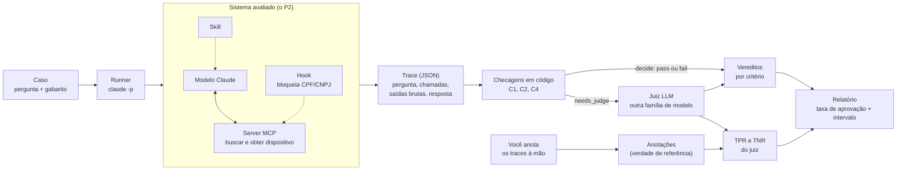

# Visão geral: de uma pergunta a um relatório

O caminho completo de um caso, do início ao número final. Cada caixa é explicada no glossário do [`README.md`](../../README.md#conceitos-explicados).

## Como ler

- **Linha cheia** é o fluxo dos dados. **Linha pontilhada** é uma peça que atua sobre outra: a skill orienta o modelo, e o hook vigia as chamadas ao server.
- O que está no quadro **"Sistema avaliado"** é o P2. O P3 não o altera: só o observa.
- O **código** decide primeiro. O juiz só entra no que o código não consegue decidir (`needs_judge`).
- O juiz **nunca vê a anotação humana**. A anotação serve só para medir o juiz (TPR e TNR) e dizer quanto confiar nele.
- O relatório junta duas coisas: **o que o sistema acerta** (taxas por critério) e **quanto o juiz merece confiança** (TPR e TNR).
