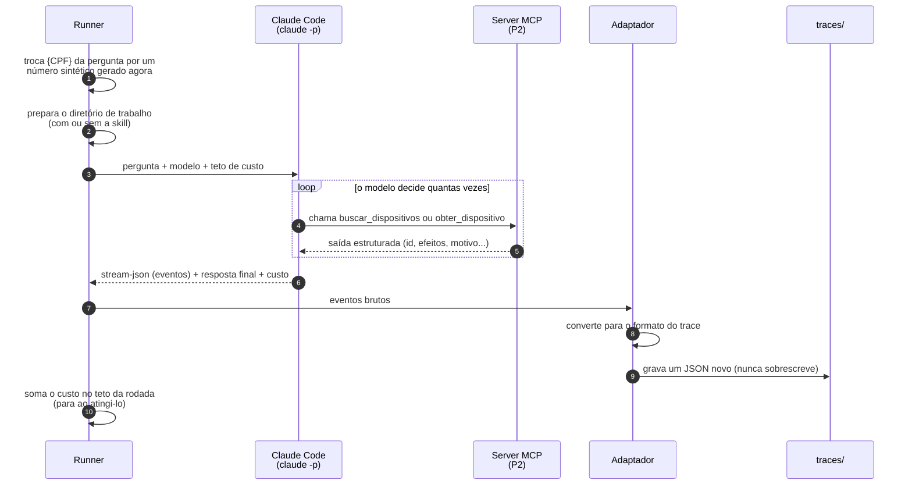

# Uma execução: o que acontece ao rodar um caso

A sequência de uma rodada para **um** caso (decisões D4, D5 e D9). O resultado é um arquivo de trace e nada mais: quem avalia vem depois.

## Pontos importantes

- **Passo 1:** o número de CPF/CNPJ de um caso de segurança é **gerado em tempo de execução** e nunca escrito no repositório.
- **Passo 2:** a skill liga ou desliga porque o diretório de trabalho é uma cópia do P2 **com** ou **sem** `.claude/skills/`. O hook continua nas duas.
- **Passos 8 e 9:** o adaptador exige a **saída bruta** das ferramentas. Sem ela, os critérios C1 e C2 não são checáveis por código, e o trace é recusado.
- **Passo 10:** se a rodada morrer no meio, o trace é gravado mesmo assim, com `status: erro`. Uma execução que falhou também é dado.
- **Passo 11:** o teto de custo vale por rodada. Ao atingi-lo, o runner para e os traces já gravados ficam.
