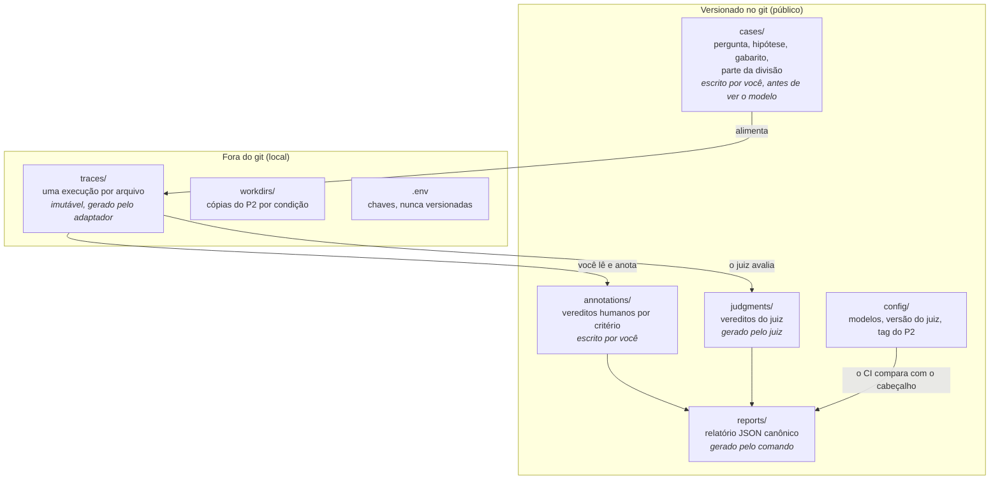

# Dados e arquivos: o que vai ao git e o que não vai

Cada tipo de arquivo tem um dono, um momento em que nasce e uma regra de mutabilidade (decisões D5, D7 e D13).

## Por que essa divisão

| Pasta | No git? | Por quê |
|---|---|---|
| `cases/`, `annotations/`, `judgments/`, `reports/`, `config/` | **Sim** | São o produto do projeto e o que o CI confere. As anotações são o ativo mais valioso. |
| `traces/` | **Não** | São brutos, grandes e mudam a cada rodada. O que vai ao git são **fixtures sintéticas pequenas**, escritas à mão, para os testes. |
| `workdirs/` | **Não** | Cópias temporárias do P2. |
| `.env` | **Não, nunca** | Guarda chaves. Nunca é exibido nem commitado. |

## Regras que valem em toda a tabela

- **O trace é imutável.** Reanotar nunca altera o trace: humano e juiz avaliam exatamente o mesmo dado.
- **Nenhum número de CPF/CNPJ, nem sintético, entra em arquivo versionado.** Isso vale também para o texto livre das anotações (`note`) e das justificativas do juiz, que poderiam citar o número visto no trace. Um teste do CI recusa qualquer sequência com formato de documento nesses arquivos.
