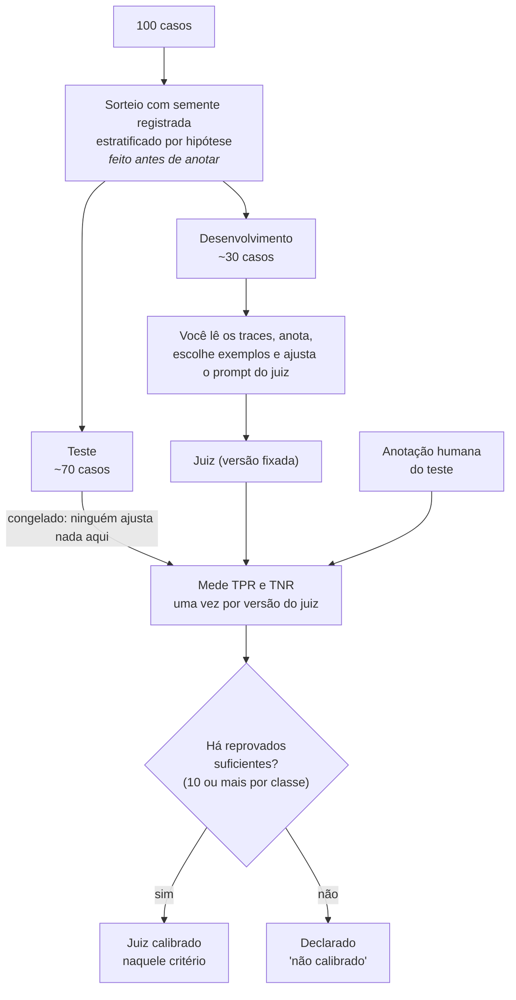

# O juiz e a calibração

Como saber quanto confiar em um juiz LLM: comparar o veredito dele com o seu, em casos que ele **não viu** durante o ajuste (decisões D6 e D8).

## O fluxo

## A tabela de acertos e erros

Para cada caso do teste, compara-se o veredito humano (a referência) com o do juiz:

| | Juiz diz **aprovado** | Juiz diz **reprovado** |
|---|---|---|
| **Você disse aprovado** | acerto (verdadeiro positivo) | erro: reprovou o que estava bom |
| **Você disse reprovado** | erro: deixou passar o que estava ruim | acerto (verdadeiro negativo) |

- **TPR** = dos casos que **você aprovou**, a fração que o juiz também aprovou.
- **TNR** = dos casos que **você reprovou**, a fração que o juiz também reprovou.

## Exemplo numérico

Você anota 10 traces: aprovou 8 e reprovou 2. O juiz aprova 7 dos seus 8 aprovados e reprova 1 dos seus 2 reprovados.

- TPR = 7 / 8 = **0,875**
- TNR = 1 / 2 = **0,5**

Um juiz que **sempre aprova** acertaria 8 dos 10 casos (80%), mas teria TPR = 1,0 e **TNR = 0**: não pega nenhuma falha. É por isso que a taxa de acerto geral esconde o problema, e por isso se medem **dois** números. Como o objetivo do P3 é **achar falhas** do P2, o TNR é o que mais importa.

## Por que o teste fica congelado

Se você ajusta o prompt do juiz olhando os mesmos casos em que depois mede o TPR e o TNR, o número fica otimista: o juiz "decorou" o conjunto. Por isso o ajuste acontece só no **desenvolvimento**, e o **teste** é medido uma única vez por versão do juiz.
