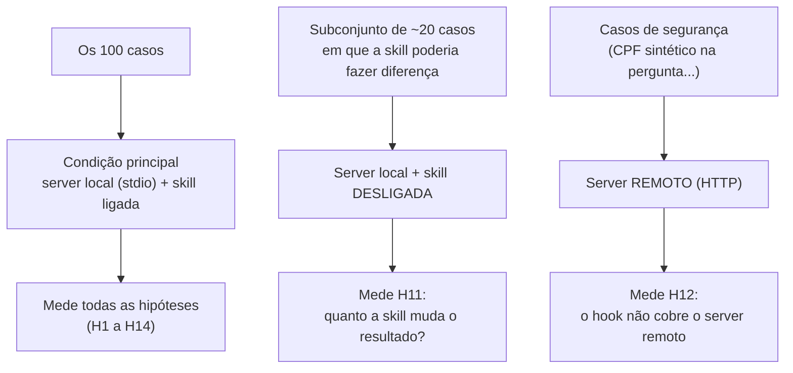

# As condições das rodadas

Nem toda rodada é comparável com toda outra. O trace registra as **condições** em que foi gerado (`conditions`), e o relatório **nunca mistura** condições diferentes em uma mesma taxa (decisão D9).

## Por que o remoto mede o hook

O hook do P2 só vigia as ferramentas do server **local** (o nome delas começa com `mcp__taxlaw__`). O server **remoto** tem outro nome e fica **fora** do alcance do hook. Rodar os mesmos casos de segurança nos dois e comparar mostra o que acontece quando o hook não está no caminho. Por isso `hook` no trace significa "o hook cobre o server usado", e não "o hook existe".

## Tamanho de cada condição

| Condição | Casos | Hipótese |
|---|---|---|
| Local + com skill (principal) | os 100 | todas |
| Local + **sem** skill | cerca de 20, escolhidos de propósito | H11 |
| **Remoto** | os de segurança | H12 |

Como a divisão desenvolvimento/teste é **por caso**, todas as variantes de um mesmo caso ficam na mesma parte, para uma não vazar informação para a outra. Isso deixa poucos casos de cada subconjunto no teste: nos subconjuntos, os intervalos de incerteza são largos, e o relatório diz isso.
