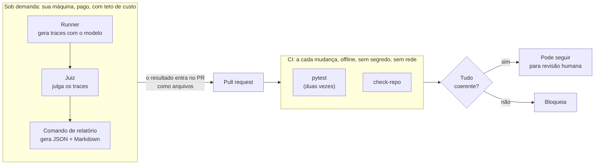

# CI offline e rodadas pagas

Duas coisas que não se misturam (decisão D7): o que roda **a cada mudança, de graça e sem segredo**, e o que roda **sob demanda, na sua máquina, com teto de custo**.

## O que o CI confere (todo offline)

1. **Privacidade:** nenhum arquivo versionado tem sequência com formato de CPF/CNPJ.
2. **Casos:** todos validam, todos têm `split`, e a semente do sorteio está registrada.
3. **Anotações e vereditos do juiz:** todos validam, e as versões de anotação de um mesmo trace têm ordem sem ambiguidade (reanotar guarda o histórico e vale a mais recente; decisão 10 em D2).
4. **A conta do juiz:** recalcula TPR/TNR a partir das anotações e dos vereditos já gravados, e confere com o relatório mais recente.
5. **Limiar:** TPR e TNR calibrados não podem ficar abaixo do mínimo combinado.
6. **Antes/depois:** o relatório mais recente tem o mesmo cabeçalho que `config/run.json`. Se mudou prompt, modelo ou tag do P2 e não há relatório novo, o CI falha com "falta um relatório novo".

## O que o CI **não** vê, e por quê

- **Os traces reais** (ficam fora do git). Ele não consegue saber se um relatório veio de uma rodada de verdade; essa proteção é a **revisão humana**.
- **O comportamento do modelo.** Rodar modelo a cada mudança custaria dinheiro, exigiria chave no CI e deixaria o CI intermitente (modelos variam), e teste intermitente é defeito. Por isso a regressão do P2 em si é uma rodada sua; o CI protege o **avaliador** e impede que a rodada seja esquecida ou que o número caia sem ninguém ver.
