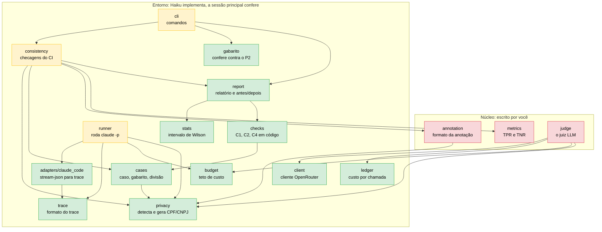

# Módulos do pacote `evals`

Quem depende de quem, e quem escreve o quê. As setas vão de **quem usa** para **quem é usado**.

## Legenda

- **Verde:** pronto, com testes passando.
- **Vermelho:** núcleo, **a escrever por você**. O Claude revisa, explica e pergunta, mas não implementa.
- **Amarelo:** entorno ainda por fazer.

## Princípios de desenho

- **Cada módulo tem uma só responsabilidade** e pode ser entendido sem ler os outros.
- **`trace` e `cases` não dependem de ninguém** além de `privacy`: o formato dos dados é a base, e nada o contorna.
- **`cli` só faz argparse** e chama as funções; nenhuma regra de negócio mora nele.
- **O núcleo depende só de peças pequenas** (`privacy`, `client`, `ledger`, `budget`): você escreve a parte que ensina, sobre uma base já testada.
