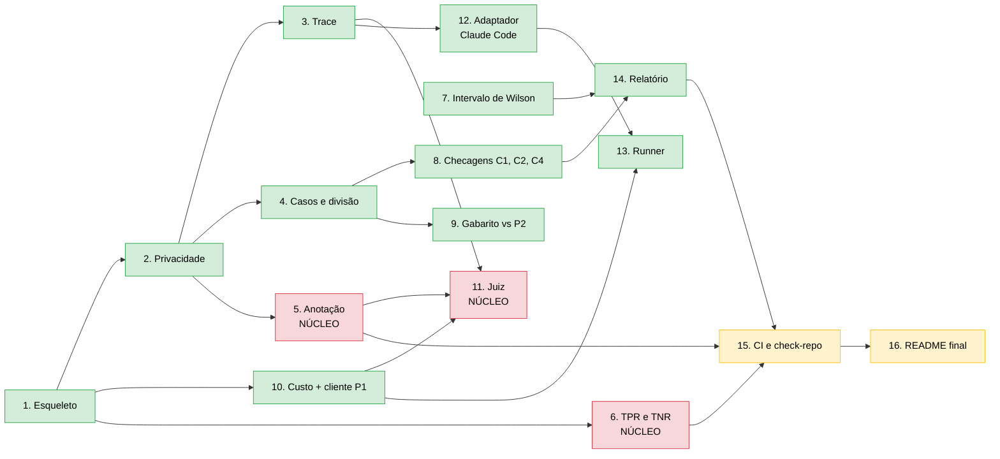

# Ordem das tarefas e andamento

As 16 tarefas do [plano de implementação](../superpowers/plans/2026-11-10-p3-evals.md), com as dependências entre elas e o que já foi feito.

## Legenda

- **Verde:** feito, com commit e tag `step-NN`.
- **Vermelho:** núcleo, a escrever por você.
- **Amarelo:** entorno ainda por fazer.

## Onde estão os bloqueios

| Tarefa | Espera por |
|---|---|
| 11 (juiz) | 5 (anotação), porque o juiz e a anotação precisam falar o mesmo formato de veredito |
| 15 (CI) | 5 e 6, porque o CI valida anotações e recalcula TPR/TNR |

## Fora do plano

- **Passo 30:** `validate_case` recusa `{CPF}`/`{CNPJ}` na pergunta sem H12 (decisão 6 da Tarefa 5).
- **Passo 31:** `check_c2` aprova sozinho o caso sem resposta quando o modelo não diz data (decisão 7).
- **Desenho da Tarefa 5 fechado** (decisões 1 a 12 em D2); o nó 5 segue vermelho porque o código é seu.

## Depois das tarefas: os marcos

O código sozinho não entrega o critério de concluído. O que entrega são os marcos que dependem de você: **escrever os 100 casos**, **a rodada piloto**, **anotar os traces**, **calibrar o juiz** e **o primeiro antes/depois**. Estão no fim do plano.
