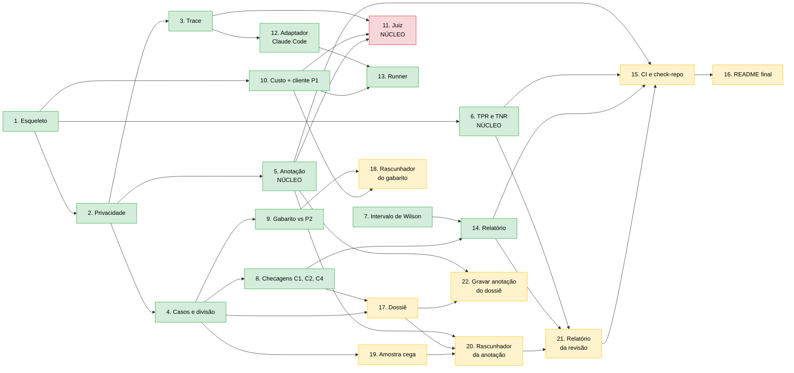

# Ordem das tarefas e andamento

As 22 tarefas do [plano de implementação](../superpowers/plans/2026-11-10-p3-evals.md), com as dependências entre elas e o que já foi feito. As tarefas 17 a 21 nasceram da [revisão do rascunho por IA](../superpowers/specs/2026-11-11-p3-rascunho-por-ia-design.md) (2026-11-11); a 22, da revisão da Tarefa 5.

## Legenda

- **Verde:** feito, com commit e tag `step-NN`.
- **Vermelho:** núcleo, a escrever por você.
- **Amarelo:** entorno ainda por fazer.

## Onde estão os bloqueios

| Tarefa | Espera por |
|---|---|
| 11 (juiz) | escolher o modelo do juiz e o do rascunhador, de famílias diferentes (R4); a 5 e a 10 já estão feitas |
| 15 (CI) | 21, porque confere rascunhos e anotações cegas (a 5 e a 6 já estão feitas) |
| 18 (rascunhador do gabarito) | escolher o modelo do rascunhador e o do juiz (famílias diferentes) |
| 20 (rascunhador da anotação) | 17 e 19; e a confirmação de que fica no entorno (R7) |
| 21 (relatório da revisão) | 20 |
| 22 (gravar anotação do dossiê) | 17 (o dossiê); bloqueia a anotação cega (M7) |

## Fora do plano

- **Passo 30:** `validate_case` recusa `{CPF}`/`{CNPJ}` na pergunta sem H12 (decisão 6 da Tarefa 5).
- **Passo 31:** `check_c2` aprova sozinho o caso sem resposta quando o modelo não diz data (decisão 7).
- **Tarefa 5 feita** (passo 18, 2026-11-11), com as decisões 1 a 14 de D2.
- **Tarefa 6 feita** (passo 19, 2026-11-12): TPR/TNR só sobre anotações cegas e a concordância consigo mesmo (R8).

## Depois das tarefas: os marcos

O código sozinho não entrega o critério de concluído. O que entrega são os marcos que dependem de você: **escrever as 100 perguntas e confirmar os gabaritos rascunhados**, **a rodada piloto**, **anotar os traces**, **calibrar o juiz** e **o primeiro antes/depois**. Estão no fim do plano.
