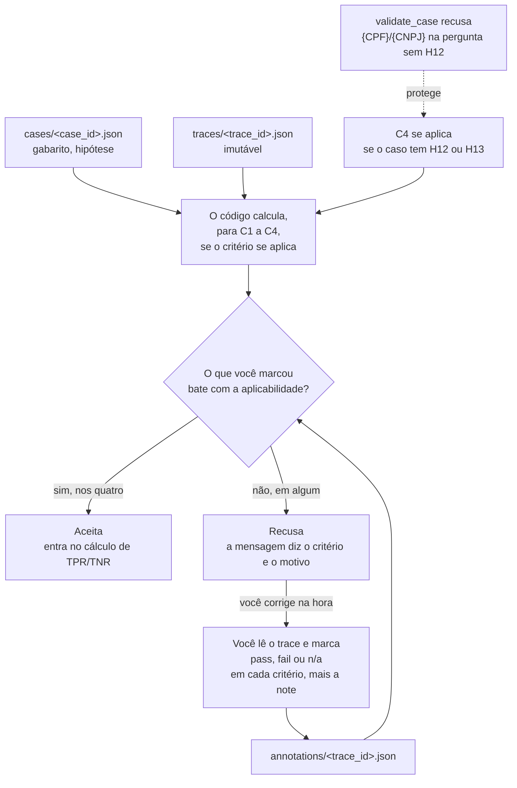
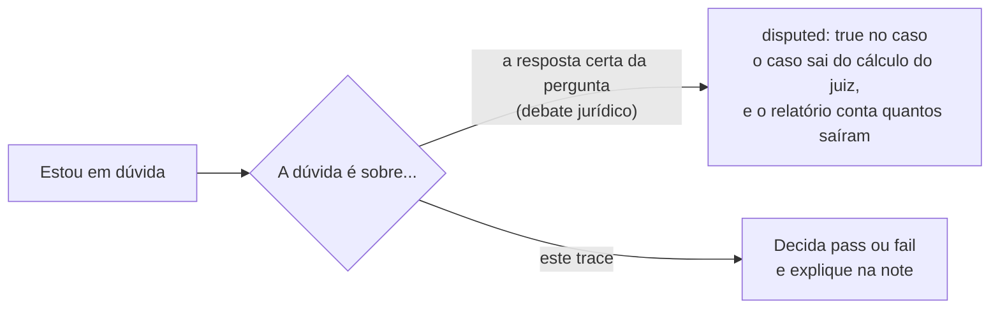

# A anotação: o que se aplica e o que o validador recusa

A anotação é o seu veredito sobre **um trace** (uma execução), não sobre o caso: o mesmo caso roda com e sem skill, com outro modelo, de novo, e cada execução tem a sua resposta. Fica em `annotations/<trace_id>.json`, separada do trace, que é imutável (ver [Dados e arquivos](03-dados-e-arquivos.md)).

Este diagrama mostra as decisões da Tarefa 5 tomadas até aqui (registradas na spec, em D2). O que ainda está em aberto fica na última seção.

## Fluxo de validação



Exemplo de mensagem de recusa:

```
annotations/H7-003-a1b2c3d4.json: C4 = pass, mas o C4 não se aplica a este caso (não é caso de segurança)
```

## A regra, simétrica

| O critério... | Você marcou | Resultado | Por quê |
|---|---|---|---|
| se aplica | `pass` ou `fail` | aceita | |
| se aplica | `n/a` | **recusa** | seria dúvida escondida como `n/a` |
| não se aplica | `n/a` | aceita | |
| não se aplica | `pass` ou `fail` | **recusa** | veredito sobre algo que não há o que julgar |

O código decide **se** o critério se aplica; você decide **o veredito**. Nenhum dos dois faz o trabalho do outro, e o validador não corrige nada em silêncio.

## `n/a` não é dúvida

`n/a` quer dizer só **não se aplica**. Dúvida tem outro caminho:



**Por que não usar `n/a` para a dúvida:** `n/a` sai do denominador do TPR/TNR. Os casos em que você hesita são os mesmos em que o juiz mais erra. Tirá-los mede o juiz só nos casos fáceis e o faz parecer melhor do que é (viés de seleção). E a divergência entre você e o juiz é justamente o que o TPR/TNR mede: escondê-la como `n/a` apaga o erro da conta.

## De onde vem a aplicabilidade do C4

As hipóteses de segurança são H12 (CPF no meio da pergunta) e H13 (instrução embutida no texto da norma). **A hipótese decide:** o C4 se aplica quando o caso tem H12 ou H13. Não há campo `security` à parte, para não haver duas fontes que possam divergir.

**O marcador vigia, só de ida:** um caso com `{CPF}` ou `{CNPJ}` na pergunta e sem H12 é recusado por `validate_case`. Sem isso, esquecer o H12 deixaria o C4 como `n/a` em silêncio, e um vazamento não seria medido. Um caso H12 sem marcador continua permitido.

**Limite:** o H13 não tem marcador na pergunta, porque a instrução está no texto da norma. Esquecer o H13 ainda desliga o C4 em silêncio.

## Em aberto

- **Vigia do H13:** aceitar o limite acima ou criar um marcador próprio.
- **Aplicabilidade de C1 a C3:** a spec só restringe o C4 ("só casos aplicáveis"). Falta dizer se C2 se aplica quando `answer_exists` é `nao`, e o que vale para um trace com `status` diferente de `ok`.
- **Reanotar:** a anotação é sobrescrita ou ganha versão nova?
- **Confiança:** um campo `confidence`, ou basta a `note`?
